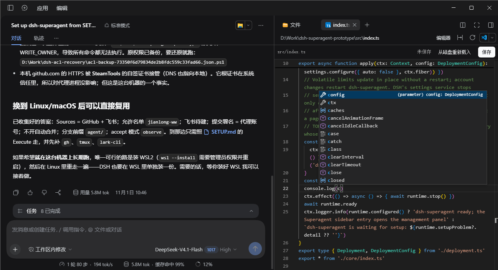

# dsh-explorer-editor

由于之前工作主要用 Cursor，习惯了 Cursor 可以直接手动编辑的能力，所以写了个让 DSH 可以直接手动编辑文件内容的小插件



## 功能

打开右侧栏里的文本文件，预览面板本身就是编辑器，不再是只读文本。集成 Monaco 的能力：高亮、行号、多光标、撤销栈、括号匹配、查找替换、快捷键等

## 支持的文件类型

| 类别 | 后缀 |
|---|---|
| 代码 | `ts tsx mts cts js jsx mjs cjs py go rs java kt kts rb php cs swift c h cpp cc cxx hpp hh m mm` |
| 标记与数据 | `json jsonc json5 css scss less html htm xml vue svelte graphql gql` |
| 文档 | `md markdown mdx txt text rst adoc` |
| 配置与脚本 | `yml yaml toml ini conf cfg env properties sh bash zsh fish ps1 psm1 bat cmd gradle sql lock log` |
| 点文件 | `gitignore gitattributes gitmodules npmrc nvmrc yarnrc editorconfig prettierrc eslintrc babelrc dockerignore clang-format tool-versions` 等（按点后面的名字匹配，例如 `.gitignore` 的后缀是 `gitignore`） |

DSH 的匹配规则是「文件名以 `.` + 后缀结尾」，因此**没有后缀的文件**（`Makefile`、`LICENSE`）和未列出的后缀仍由内置只读视图打开。图片、PDF、Office 文档不会被接管；Markdown 默认进编辑器，但内置的渲染视图仍在视图菜单里可切回。

## 要求

- DSH `0.2.1-rc.5` 及以上

## 安装

```sh
dsh plugin --profile desktop add @jianlong-ww/dsh-explorer-editor # 桌面应用
dsh plugin --profile web add @jianlong-ww/dsh-explorer-editor     # 浏览器端
```

也可以用 GitHub Release 里的预构建包（与 npm 上的内容相同，适合不方便访问 npm 的环境）：

```sh
dsh plugin --profile desktop add https://github.com/jianlong-ww/dsh-explorer-editor/releases/download/v0.1.0/dsh-explorer-editor-0.1.0.tgz
```

不建议用 `github:` 或 `git+https://` 安装：仓库不包含编译产物，pnpm 会把 git 依赖当成待构建的包去装它的 devDependencies（含 `monaco-editor`），在 Windows 上还会因跨盘符号链接而报 `EPERM`。

装完**重启 dsh**，然后刷新页面。

卸载：

```sh
dsh plugin --profile desktop remove @jianlong-ww/dsh-explorer-editor
```

### 从源码安装

```sh
git clone https://github.com/jianlong-ww/dsh-explorer-editor.git
cd dsh-explorer-editor
pnpm install && pnpm build
dsh plugin --profile desktop add .
```

## License

MIT，见 [LICENSE](LICENSE)。内置的 Monaco 构建来自 `monaco-editor`（MIT）。
